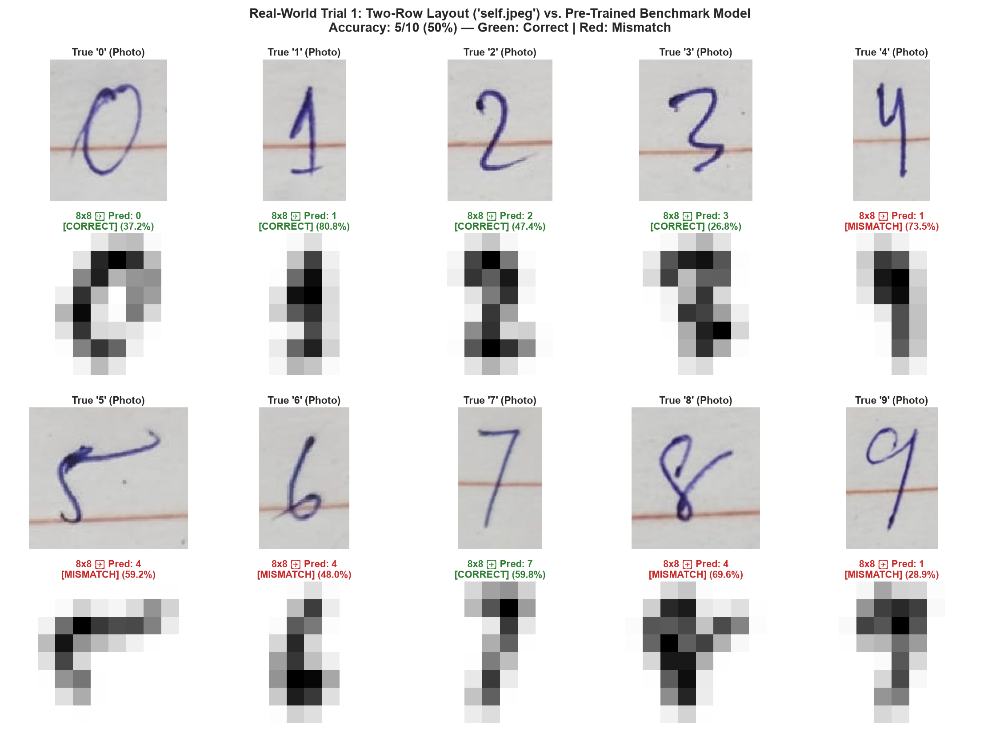
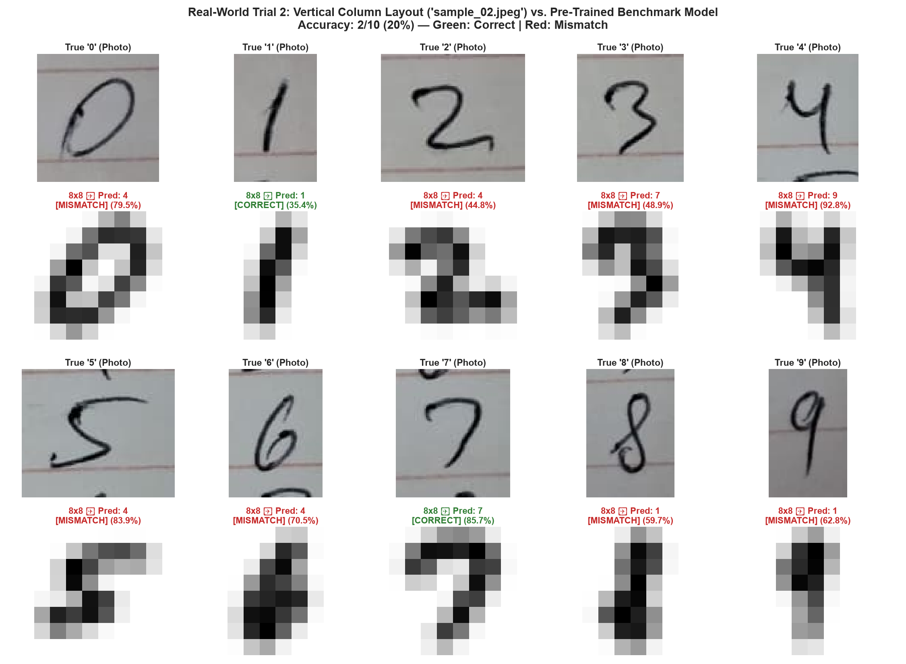
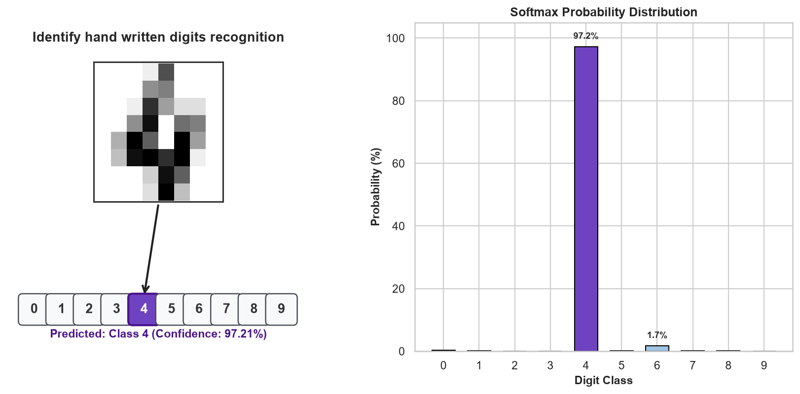

# 🖋️ Handwritten Digit Recognition
### Benchmarking Controlled Laboratory Baselines vs. Real-World Handwritten Digit Realities (Trial 1)

[](https://www.python.org/downloads/)
[](LICENSE)
[](https://scikit-learn.org/)
[](#-laboratory-benchmark-performance)
[](#-the-reality-gap-benchmark-vs-real-world-domain-shift-trial-1)

An end-to-end Machine Learning pipeline, interactive Jupyter Notebook, and computer vision evaluation suite for handwritten digit recognition ($0 - 9$).

This repository benchmarks ideal laboratory conditions against real-world camera captures, contrasting **Scikit-Learn Digits** ($8 \times 8$ pixels, **99.17% accuracy**) and **UCI PenDigits** (16-feature trajectories, **98.26% accuracy**) with **Custom Trial 1**—real-world smartphone handwriting photographed on lined notebook paper, showcasing empirical **domain shift** and practical computer vision preprocessing.

---

## 📌 Project Architecture & Two-World Philosophy

In machine learning research, controlled datasets often report >99% test accuracy. However, deploying those models on raw, uncurated human handwriting frequently reveals severe vulnerabilities. This repository cleanly divides data and evaluation into two distinct domains:

```
                      ┌───────────────────────────────────────────────┐
                      │         Handwritten Digit Recognition         │
                      └───────────────────────┬───────────────────────┘
                                              │
                      ┌───────────────────────┴───────────────────────┐
                      ▼                                               ▼
          [ Ideal Benchmark World ]                       [ Real-World Trial World ]
       • Controlled normalization                      • Uncurated camera captures
       • Centered 8x8 pixel matrices                   • Notebook ruling lines & paper textures
       • Scikit-Learn Digits (99.17%)                  • Ballpoint pen stroke variations
       • UCI PenDigits Trajectory (98.26%)             • Custom Trial 1 (`self.jpeg` -> 50%)
```

1. **The Ideal Benchmark (`data/benchmark/` & `results/benchmark/`)**:
   - Standardized Scikit-Learn Digits ($8 \times 8$ grayscale, 1,797 samples).
   - UCI Pen-Based Trajectory Digits (16 coordinates, 10,992 samples).
   - High test accuracy (**99.17%** for pixels, **98.26%** for pen trajectories).
2. **Real-World Custom Trials (`data/custom_trials/` & `results/custom_trials/`)**:
   - **Trial 1 (`trial_01_phone_lined_paper`)**: An unedited photo of 10 digits (`0` through `9`) written in blue ballpoint ink on red-lined notebook paper taken with a smartphone camera (`self.jpeg`).
   - Evaluates real-world domain adaptation, color space segmentation, morphological dilation, and classification bottlenecks.

---

## 🔬 The Reality Gap: Benchmark vs. Real-World Domain Shift (Trials 1 & 2)

| Dimension | Ideal Benchmark (Scikit-Learn) | Real-World Trial 1 (`self.jpeg`) | Real-World Trial 2 (`sample_02.jpeg`) |
| :--- | :--- | :--- | :--- |
| **Source Image** | Digitized, pre-centered $8 \times 8$ bitmaps | High-res photo ($4000 \times 3000$ px) | Smartphone photo ($1280 \times 720$ px) |
| **Writing Tool** | NIST standardization (thick uniform strokes) | Blue ballpoint pen (~1–2 px stroke) | Black/blue pen (~1–2 px stroke) |
| **Layout** | Pre-isolated individual characters | Horizontal 2-row layout | Single **vertical column** (0 down to 9) |
| **Canvas / Background**| Uniform solid dark background (value 0) | Cream paper with red notebook lines | Gray-lined notebook paper with lighting gradient |
| **Preprocessing** | None required (pre-extracted features) | Blue-ink difference thresholding | Morphological grey opening line suppression |
| **Model Test Accuracy** | **99.17% (357 / 360 correct)** | **50.0% (5 / 10 correct)** | **20.0% (2 / 10 correct)** |

### 🔍 Key Findings from the Real-World Trials:
1. **Trial 1 (50% Accuracy - 2-Row Layout)**:
   - **Correctly Classified (5/10)**: `0`, `1`, `2`, `3`, `7`.
   - **Misclassified (5/10)**: `4`, `5`, `6`, `8`, `9`.
   - Blue-ink difference filtering `(b - r) > 10` eliminated red notebook lines, and morphological dilation thickened strokes.
2. **Trial 2 (20% Accuracy - Vertical Column Layout)**:
   - **Correctly Classified (2/10)**: `1`, `7`.
   - **Misclassified (8/10)**: `0`, `2`, `3`, `4`, `5`, `6`, `8`, `9`.
   - **The Tall/Narrow Aspect Ratio Bottleneck**: In Trial 2, digits are written tall and narrow ($h \approx 2 \times w$). When padded into a square canvas, the digit occupies only 2–3 columns in the center of the $8 \times 8$ grid. This creates an overwhelming feature bias toward **class `4`** (predicted for 0, 2, 5, 6) and **class `1`** (predicted for 8, 9).




---

## 📈 Laboratory Benchmark Performance

Evaluated using 5-Fold Stratified Cross-Validation and held-out test splits:

| Model | 5-Fold CV Accuracy (%) | Test Accuracy (%) | Weighted F1-Score |
| :--- | :---: | :---: | :---: |
| **Support Vector Classifier (SVC - RBF)** | **98.82%** | **99.17%** | **0.9917** |
| **Multi-Layer Perceptron (MLP Neural Net)** | 97.63% | 98.61% | 0.9861 |
| **K-Nearest Neighbors (KNN, k=5)** | 98.68% | 98.33% | 0.9834 |
| **Random Forest (100 Trees)** | 97.29% | 96.11% | 0.9611 |
| **Logistic Regression (Multinomial)** | 96.38% | 95.83% | 0.9583 |

> **Best Tuned Model**: `SVC(C=5.0, gamma=0.05, kernel='rbf')` achieves **>99% accuracy** on the Scikit-Learn test set and **98.26%** on UCI PenDigits.

---

## 📁 Repository Structure

```
Hand-Digit-Recognition/
├── handwritten_digit_recognition.ipynb  # Notebook 1: Ideal Benchmark (Scikit-Learn & UCI PenDigits)
├── custom_handwritten_trials.ipynb      # Notebook 2: Real-World Custom Trials (Evaluates Trials 1 & 2)
├── requirements.txt                     # Project dependencies
├── README.md                            # Comprehensive documentation & findings
├── LICENSE                              # MIT License
├── CONTRIBUTING.md                      # Contribution guidelines
├── CODE_OF_CONDUCT.md                   # Community guidelines
│
├── data/                                # Cleanly categorized raw inputs
│   ├── benchmark/                       # Controlled lab datasets
│   │   ├── uci_pendigits/               # UCI pendigits.tra, pendigits.tes (10,992 samples)
│   │   ├── zip/                         # Archived dataset source archives
│   │   └── references/                  # Dataset reference URLs & documentation
│   └── custom_trials/                   # Real-world and external test inputs
│       ├── trial_01_phone_lined_paper/  # self.jpeg (horizontal 2-row layout)
│       ├── trial_02_vertical_column/    # sample_02.jpeg (single vertical column layout)
│       └── samples/                     # Synthetic test sample digits
│
├── results/                             # Categorized analytical outputs & charts
│   ├── benchmark/                       # Benchmark plots (confusion matrix, PCA/t-SNE, demo)
│   │   ├── confusion_matrix.png
│   │   ├── digit_recognition_demo.png
│   │   ├── mean_digits_template.png
│   │   ├── model_comparison.png
│   │   ├── pca_tsne_projections.png
│   │   └── pen_trajectories.png
│   └── custom_trials/                   # Custom trial diagnostics
│       ├── trial_01_phone_lined_paper/  # self_handwriting_evaluation.png
│       ├── trial_02_vertical_column/    # trial_02_evaluation.png
│       └── samples/                     # custom_prediction_sample_digit_3.png
│
├── scripts/                             # Executable Python workflows
│   ├── run_benchmark.py                 # Full benchmark training & evaluation suite
│   ├── evaluate_trial_1.py              # Real-world Trial 1 multi-digit evaluator
│   ├── evaluate_trial_2.py              # Real-world Trial 2 vertical column evaluator
│   ├── predict_single_image.py          # Single image inference CLI tool
│   ├── generate_notebook.py             # Benchmark notebook generator & executor
│   └── generate_trials_notebook.py      # Custom trials notebook generator & executor
│
└── models/                              # Serialized model & scaler joblib artifacts
    ├── best_digits_svm_model.joblib
    ├── minmax_scaler.joblib
    ├── pendigits_svm_model.joblib
    └── pendigits_scaler.joblib
```

---

## ⚙️ Installation & Usage

### 1. Install Dependencies
```bash
pip install -r requirements.txt
```

### 2. Run the Benchmark Pipeline
Train the benchmark models, run hyperparameter tuning, evaluate metrics, and save figures:
```bash
python scripts/run_benchmark.py
```

### 3. Evaluate Real-World Custom Trial 1 (`self.jpeg`)
Run evaluation on the phone-captured 2-row lined paper:
```bash
python scripts/evaluate_trial_1.py
```
This produces `results/custom_trials/trial_01_phone_lined_paper/self_handwriting_evaluation.png`.

### 4. Evaluate Real-World Custom Trial 2 (`sample_02.jpeg`)
Run evaluation on the phone-captured vertical column lined paper:
```bash
python scripts/evaluate_trial_2.py
```
This produces `results/custom_trials/trial_02_vertical_column/trial_02_evaluation.png`.

### 5. Test Any Arbitrary Single Image
Test inference on an individual handwritten digit image with automatic centering and polarity detection:
```bash
python scripts/predict_single_image.py data/custom_trials/samples/sample_digit_3.png
```
Or provide any custom `.png` / `.jpg` path:
```bash
python scripts/predict_single_image.py path/to/your/digit.png
```

### 6. Interactive Jupyter Notebooks
You have two pre-executed interactive notebooks at the repository root:
* **Notebook 1: Benchmark Baseline (`handwritten_digit_recognition.ipynb`)**
  ```bash
  jupyter notebook handwritten_digit_recognition.ipynb
  ```
* **Notebook 2: Real-World Custom Trials (`custom_handwritten_trials.ipynb`)**
  ```bash
  jupyter notebook custom_handwritten_trials.ipynb
  ```


---

## 🖼️ Benchmark Visual Recognizer

When running inference on ideal digits, the pipeline produces:
1. Rendered $8 \times 8$ grayscale digit image.
2. Highlighted keypad button (`[0] [1] [2] [3] [*4*] [5] [6] [7] [8] [9]`).
3. Softmax probability confidence distribution (>97% certainty).



---

## 📄 License & Community

* **License**: Released under the [MIT License](LICENSE).
* **Code of Conduct**: Please review our [Code of Conduct](CODE_OF_CONDUCT.md).
* **Contributing**: Check out our [Contributing Guidelines](CONTRIBUTING.md) to get involved.

